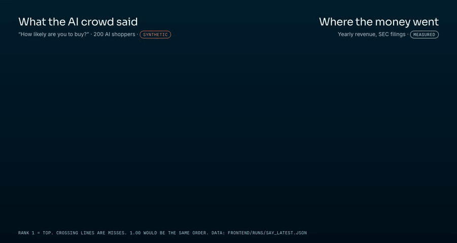
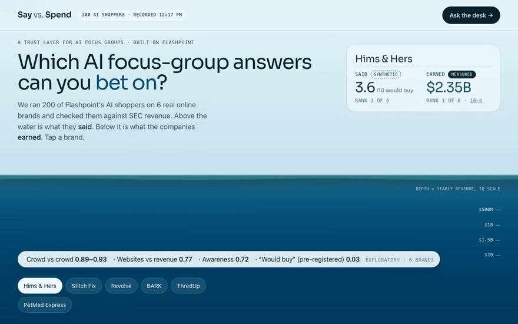
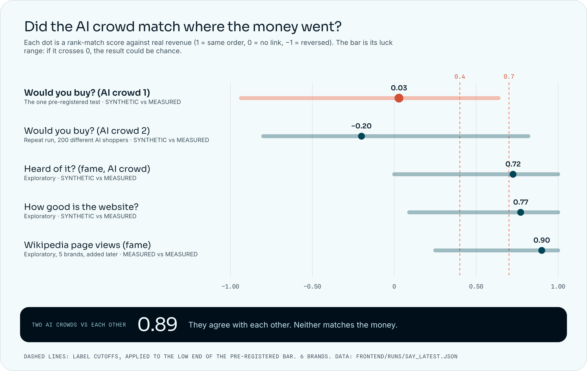
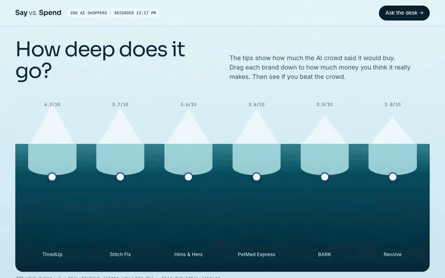
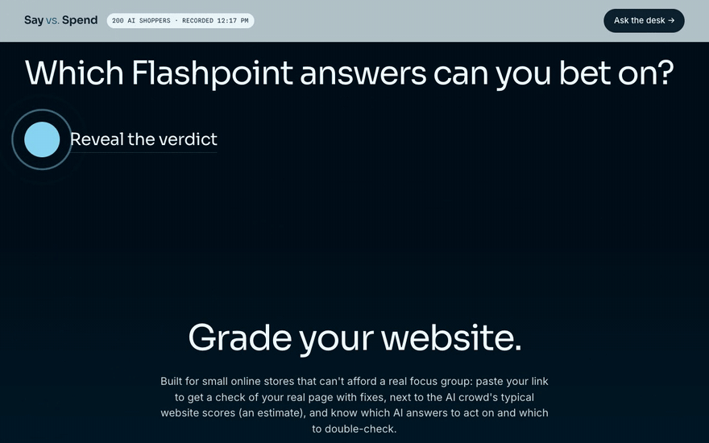
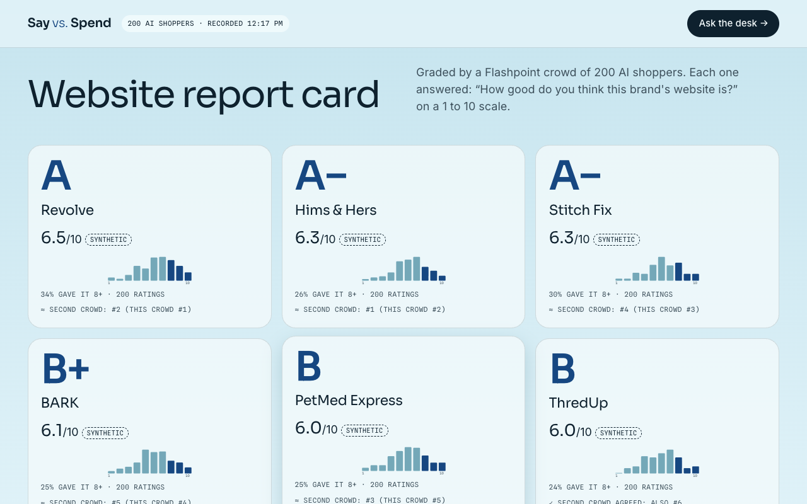
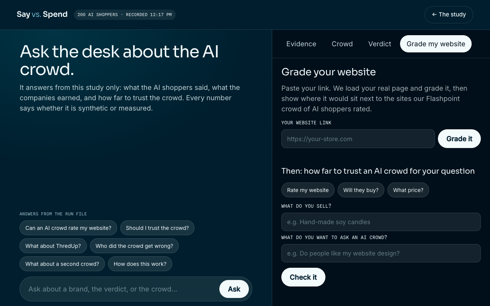
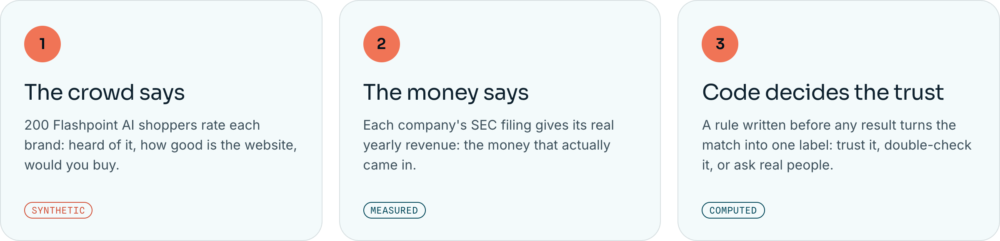
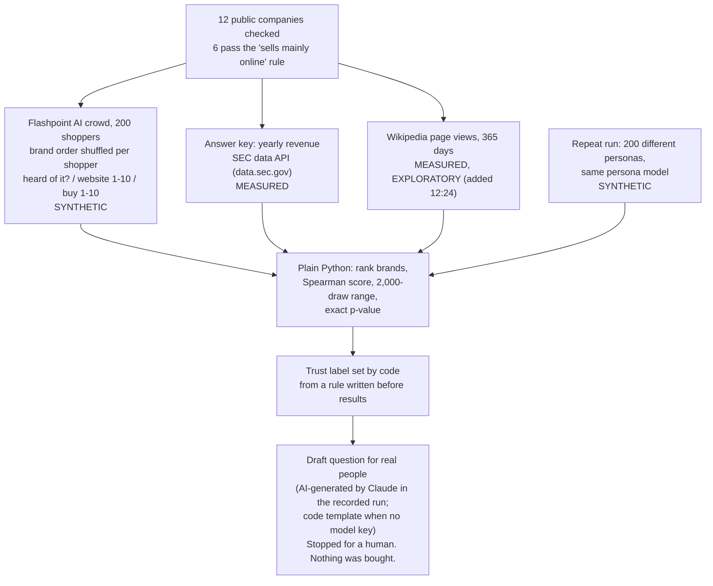

<p align="center">
  
</p>

# Say vs. Spend

**AI focus groups are almost free. We built a test that tells you how far to trust one, by checking it first where the real answer is known.**

<p align="center">
  
  
  
  
</p>

<p align="center">
  <a href="#what-we-found"><b>Results</b></a> ·
  <a href="#try-the-page"><b>Try the page</b></a> ·
  <a href="#how-it-works"><b>How it works</b></a> ·
  <a href="#limits"><b>Limits</b></a> ·
  <a href="#how-to-run-it"><b>Run it yourself</b></a>
</p>

Built in one day at the Hack the Unreachable AI Hackathon, Fordham University, November 14, 2026, by Jayden and Daniel.

---

## The question

**Did the AI crowd understand shoppers, or did it just pick the famous brands?**

A small online store can't pay thousands for a real focus group. An AI focus group (a "synthetic panel": AI-made shoppers) costs almost nothing. Nobody tells the owner whether to believe it.

So we tested one where the answer is already known. 200 AI shoppers rated 6 public companies that sell mainly online. We checked their ranking against where the money really went: each company's yearly revenue from its SEC filing. We also checked it against fame alone. The crowd only gets credit if it beats fame.

<p align="center">
  
  <br><sub>Our page: above the water is what the AI crowd <b>said</b>. Below it is what each company really <b>earned</b> (to scale).</sub>
</p>

## What we found

**Two AI crowds agree with each other. They do not agree with where the money goes.**

<p align="center">
  
</p>

**The pre-registered result:** the AI crowd's buying ranking matched revenue at **0.03** (exact p = 1.00). The code's label is **Ask real people.** This was the only score we wrote down before computing any result (plus the yes/no check "did it beat fame?"). Every other number below is **EXPLORATORY** (not pre-registered).

Labels: **MEASURED** = real public data. **SYNTHETIC** = from the AI crowd. **AI-generated** = text written by a model. **ESTIMATE** = our own rough number. **EXPLORATORY** = computed, but not part of the pre-registered test.

The score is Spearman rank agreement: 1 = same order as revenue, 0 = no connection, -1 = reversed. The range is the middle 90% of 2,000 resamples of the brand list, drawn with replacement (a "bootstrap"). Because a bootstrap is shaky with only 6 brands, we also give an **exact p-value**: the share of all possible orderings of the brands (720 for 6 brands) that match revenue at least as strongly, in either direction (`exact_p` in `say/compare.py`). If p is above 0.05, or the range includes 0, the result could be chance.

| Ranking compared with real revenue (6 brands) | Score | Exact p | 90% range | Label |
|---|:---:|:---:|:---:|---|
| AI crowd: "How likely are you to buy?" (**the pre-registered test**) | **0.03** | 1.00 | -0.94 to 0.64 | PRE-REGISTERED. SYNTHETIC vs. MEASURED |
| AI crowd: "Have you heard of it?" (fame) | 0.72 | 0.11 | 0.00 to 1.00 | EXPLORATORY (pre-registered only as the bar the buying score had to beat). Could be chance. SYNTHETIC vs. MEASURED |
| AI crowd: "How good is the website?" | 0.77 | 0.10 | 0.09 to 1.00 | EXPLORATORY. Could be chance. SYNTHETIC vs. MEASURED |
| Wikipedia page views, past 365 days (fame from outside the crowd; 5 brands; added at 12:24, after the main result was seen) | 0.90 | 0.08 * | 0.25 to 1.00 | EXPLORATORY. Could be chance. MEASURED vs. MEASURED |

\* Stored in the run file as `fame_wiki.agreement.p_exact` = 0.083. The red team got the same value independently (`docs/RED-TEAM.md`).

- **Trust label: Ask real people.** Set by code from the pre-registered rule. The low end of the buying score's range is -0.94, far under the 0.4 cutoff.
- **Did the crowd beat fame?** No. Buying score 0.03 vs. fame 0.72 (both SYNTHETIC vs. MEASURED). This yes/no test was pre-registered.
- **A second panel of 200 different personas from the same persona model (gpt-5.4-mini)** (the repeat run, EXPLORATORY) ranked the brands almost the same way. Agreement between the two panels on buying: 0.89 (SYNTHETIC vs. SYNTHETIC). No brand moved more than 1 place. That shows the model is consistent, not that it is right. The second panel's buying score against revenue: -0.20 (range -0.80 to 0.82; exact p = 0.71, run file `repeat_run.agreement.intent.p_exact`; SYNTHETIC vs. MEASURED).
- **Robustness checks (EXPLORATORY):** with the two late brands added (8 brands; run file `extras.sensitivity`, display only), buying vs. revenue = -0.14 (range -0.78 to 0.54), same label. Red-team check (`docs/RED-TEAM.md`, script outside this repo; UNVERIFIED: not reproducible from here): resampling the 200 personas with replacement 2,000 times (a bootstrap; brands fixed), the buying score's median = -0.14 (5th to 95th percentile: -0.49 to 0.14). Both stay near zero, like the main result.
- **Biggest miss: ThredUp.** The crowd ranked it #1 for buying (SYNTHETIC). By revenue it is #5 of 6 (MEASURED).
- **Be careful with the website score.** It matched revenue at 0.77 (exact p = 0.10, so it could be chance), but it was not our pre-registered test (EXPLORATORY). All six website averages sit between 6.0 and 6.5 out of 10 (SYNTHETIC), so small differences decide the order. In the repeat panel it fell to 0.54 (SYNTHETIC vs. MEASURED, EXPLORATORY).
- **The one question to ask real shoppers:** "When shopping online for clothing, shoes or accessories, how do you feel about buying used items instead of new ones?" **AI-generated:** in the recorded run Claude (`claude-sonnet-5-5`) wrote these words (run file `trust_card.draft_question_source`). Our code picked the brand (ThredUp, the biggest miss) and set the label; the model did neither. The three follow-up WHY summaries are AI-generated too, and labeled so in the run file. Then the tool stops: *"Stopped for a human. Nothing was bought."*
- **Cost of the recorded run:** about $0.04 in model calls (ESTIMATE, from our call counter and list prices; 6 calls). Flashpoint showed no charge for the AI panels (UNVERIFIED). No real respondents were bought.

### The six brands, side by side

| Brand | Yearly revenue (MEASURED) | Revenue rank (MEASURED) | Crowd buying rank (SYNTHETIC) | Crowd fame rank (SYNTHETIC) | Wikipedia rank (MEASURED, EXPLORATORY) |
|---|---:|:---:|:---:|:---:|:---:|
| Hims & Hers | $2,347.6M (FY2025) | 1 | 3 | 2 | 1 |
| Stitch Fix | $1,348.1M (FY2026) | 2 | 2 | 1 | 2 |
| Revolve | $1,225.7M (FY2025) | 3 | 6 | 3.5 (tie) | no article |
| BARK | $394.8M (FY2026) | 4 | 5 | 6 | 4 (BarkBox article) |
| ThredUp | $310.8M (FY2025) | 5 | **1** | 3.5 (tie) | 3 |
| PetMed Express | $179.0M (FY2026) | 6 | 4 | 5 | 5 |

Revenue and filing links are in `say/brands/`. Wikipedia ranks are the order of the 365-day page-view counts in `say/fame/wikipedia_pageviews.json`. Our script found no English Wikipedia article for Revolve (three titles checked, `say/fame/wiki.py`), so that line uses 5 brands. For BARK it uses the BarkBox article (BARK's main product brand; flagged as an uncertain match in `say/fame/wiki.py`).

## Try the page

**Guess first, then compare.** Drag each brand to how much money you think it makes, lock in, and see if you beat the AI crowd.

<p align="center">
  
  <br><sub>The guesses in this recording are made-up demo inputs, not data.</sub>
</p>

**Then the verdict.** It shows which kinds of AI-crowd answers looked promising and which did not, and ends on the pre-registered label.

<p align="center">
  
</p>

<table>
  <tr>
    <td width="50%"></td>
    <td width="50%"></td>
  </tr>
  <tr>
    <td align="center"><sub><b>Website report card</b>: what the AI shoppers said about each site (SYNTHETIC)</sub></td>
    <td align="center"><sub><b>Grade my website</b>: for a store owner's own site and question (EXPLORATORY)</sub></td>
  </tr>
</table>

## For a store owner: "Grade my website" (EXPLORATORY)

The desk page has a **Grade my website** tab for store owners.

**Grade my website** (`frontend/server.py`, `/api/grade-site`). Paste a link. The server loads the real public page (public addresses only, 10-second timeout, 2 MB cap) and runs 10 code checks, each with a suggested fix (score out of 10, ESTIMATE). With a key, Claude adds a short read (1 call, AI-generated). This is not a Flashpoint panel. The result is shown next to the range the AI crowd gave 12 real brands (5.7 to 7.0, SYNTHETIC).

Below it, a store owner types what they sell and what they want to learn from an AI crowd. The tab answers two more things, using only today's evidence.

**1. How far to trust an AI crowd for that kind of question** (`say/trust_check.py`). Claude (`claude-sonnet-5-5`, one call) sorts the question into a kind and drafts one question to ask real people. It never sees a number, the revenue or the verdict. Code picks the evidence line and the answer:

| Kind of question | Evidence line (6 brands) | Score vs. revenue | Second crowd agrees | Answer (set by code) |
|---|---|:---:|:---:|---|
| Will people buy? | Buying, **pre-registered** | 0.03 | (not used) | **Ask real people** |
| Do people like my website? | Website score, EXPLORATORY | 0.77 | 0.77 | Promising for perception, not proven (exploratory) |
| Have people heard of us? | Fame, EXPLORATORY | 0.72 | 0.93 | Promising for perception, not proven (exploratory) |
| Anything else (price, features, ads) | None tested | (none) | (none) | Ask real people |

The "perception" answer is an EXPLORATORY rule we added at 13:30, after the results were known: the score against revenue and the agreement between two AI crowds must both be at least 0.7 (the same number as the pre-registered "Trust it" cutoff). With 6 brands, both lines could still be chance (exact p = 0.10 and 0.11). The answer also shows the second crowd's own match with revenue: 0.54 for the website score and 0.83 for fame (SYNTHETIC vs. MEASURED, could be chance). A buying question never gets this answer. With no key, code keywords and a question template stand in for Claude.

**2. The score our AI crowd would likely give your website** (`say/predict.py`; ESTIMATE, SYNTHETIC). The crowd rated all 12 brands' websites between 5.7 and 7.0 out of 10 (SYNTHETIC): it rates almost every site about the same. We tested whether Claude can predict the crowd by hiding one brand at a time (leave-one-out on 12 brands, 12 calls, about $0.03 ESTIMATE; `say/panels/predict_validation.json`):

- Website score: Claude was off by 0.29 on average, vs. 0.26 for simply guessing the average. Claude did not win, so the tool uses the average.
- Buy score: Claude was off by 0.41, vs. 0.60 for the average. The tool uses Claude when a key is set, and says so when it can't.

A good prediction of the AI crowd is still not a prediction of real buyers: on the 6 main brands, the crowd's buying ranking matched real revenue at only 0.03.

## How it works

<p align="center">
  
</p>



1. **Brands and the answer key.** Each brand has a file in `say/brands/` with yearly revenue, fiscal year and the SEC filing link. Revenue comes from the SEC's free data service (`data.sec.gov`, no key needed).
2. **The AI crowd.** One Flashpoint panel of 200 AI shoppers answered four questions per brand: heard of it (yes/no), how good is the website (1-10), how likely to buy in the next 12 months (1-10), and is this a kind of product you buy (yes/no). Brand order was shuffled for each shopper. We exported the raw answers and counted them in code.
3. **The comparison.** `say/compare.py` ranks the brands and computes the Spearman scores, the 2,000-draw ranges (fixed seed, so the same input gives the same output) and the exact p-values (all orderings of the brands).
4. **The label.** Code picks the label from the pre-registered rule. A model may write the explaining sentence; it never picks the label.
5. **The page.** Daniel's page reads one file: `frontend/runs/say_latest.json`.

## Why you can trust our process

This public repo is a one-commit clean copy. The commit IDs below are from our development repo, which we kept private because its history held unrelated personal information. Its full commit list with times is in `docs/DEV-HISTORY.md` (UNVERIFIED for outside readers: those IDs can't be checked on GitHub).

1. **We wrote the rule before any result existed.** The rule was committed at 11:47 AM ET (commit `ff5b31a`). We changed one thing at 12:09 (commit `8ebf44a`, stamped 12:09:14; the rule text and log say 12:10): the cutoffs now apply to the low end of the range, not the single score. That makes "Trust it" harder to earn, not easier. At that moment one panel had finished, but no statistic had been computed. The first statistic appears in commit `6a6ee7f` at 12:21. Each of these commits was pushed to GitHub within about a second of being made (our local push log; UNVERIFIED: local log, not in this repo).
2. **The brand set was fixed before any result.** The 6 passing brands were committed at 12:01 (commit `1bdd084`), before any panel result existed (the first panel finished about 12:02). Later, two more brands (FIGS, CarParts.com) passed a recheck. We kept them out because the brand set was locked when the first statistic was computed. They are not in the main result. They appear only in the labeled 8-brand sensitivity view (run file `extras.sensitivity`, EXPLORATORY, display only).
3. **The inclusion rule.** A brand counts only if (a) its revenue is verified from the SEC data API and (b) the company's own investor page or annual report says it sells mainly through its own website or app. Evidence for each brand: `say/brands/VERIFICATION-NOTES.md`.
4. **Real revenue as the answer key.** Revenue numbers come from the SEC's data API, not from news sites or the AI.
5. **Independent recount.** A second script (`say/audit/recount.py`), written without reading our main code, recounted every number from the raw survey file. 0 mismatches, including all 4,800 individual answers (`say/audit/RECOUNT.md`).
6. **Repeat run.** A second panel of 200 different personas from the same persona model (gpt-5.4-mini) answered the same questions (the main panel also had a fourth question). Its label would also be "Ask real people." This shows the model is consistent, not that it is right.
7. **Outside fame check (EXPLORATORY).** Wikipedia page views give a fame ranking that does not come from the AI crowd. We added it at 12:24, after the main result was seen, and say so. It covers 5 brands, and BARK uses the BarkBox article.
8. **Code decides, not AI.** All counting, ranking and statistics are plain Python. Say vs. Spend has 253 automated checks (`say/tests`), all passing, plus 101 for our earlier Crowd Coach prototype (`agent/tests`), all passing (Nov 14).
9. **Honest disclosures.** One company's revenue (FIGS) was seen during an SEC data test before brands were picked; it is not in the main result. The full timeline is in `docs/METHODS-CARD.md`.

## How we checked ourselves

- **Red team** (`docs/RED-TEAM.md`): a reviewer playing the toughest judge looked for overclaims. Its fixes are in: exact p-values, EXPLORATORY labels, and the limits below.
- **Audits** (`docs/audit/`): data (`DATA-AUDIT.md`), idea and story (`IDEA-AUDIT.md`), public-repo safety (`PUBLIC-REPO-AUDIT.md`), and reproducibility from a fresh clone (`REPRO-AUDIT.md`).
- **Independent recount** (`say/audit/RECOUNT.md`): 0 mismatches.
- **Real people kit** (`docs/REAL-PEOPLE-KIT.md`): how to ask the drafted question to real people by hand. With 10 to 20 people that is a demo of closing the loop, not a result.

## Limits

- **Only 6 brands.** That is why the ranges are so wide. With 6 brands, even fame's range reaches 0. It also means "Trust it" needs a near-perfect ranking: in a red-team probe, swapping just the top two brands already drops the label to "double-check it" (`docs/RED-TEAM.md`). The rule is cautious on purpose, and we did not change it after results. Our finding is "the crowd did not earn trust here," not "AI crowds never work."
- **One pre-registered test.** Only the buying ranking vs. revenue (and "did it beat fame?") was written down before results. The run file holds 12 rank scores against revenue (counting the repeat panel and the 8-brand sensitivity); every other one is EXPLORATORY.
- **Wide wobble.** The buying score's range runs from -0.94 to 0.64. The data cannot pin the true score down.
- **The AI shoppers are synthetic and uncalibrated.** Flashpoint's own metadata says the answers were generated by "gpt-5.4-mini" and marked "uncalibrated." Our label is about this crowd on this day.
- **Revenue measures business size, not how many people buy.** Revenue = number of customers x spend per customer (plus any non-US sales). A crowd can be right about who shops and still miss revenue.
- **Revenue is total revenue, not website-only sales.** It includes wholesale and worldwide sales. Business models differ too: some companies earn from subscriptions, and resale revenue may count only the company's cut of each sale (UNVERIFIED for ThredUp's exact accounting).
- **Fame is measured by proxies.** "Heard of it" comes from the same AI crowd. Wikipedia page views are an outside proxy, missing one brand (Revolve), with BARK measured by the BarkBox article.
- **Saying isn't buying.** Both crowd answers are stated opinions. Only revenue is real spending.
- **Fiscal years differ** between companies (FY2025 and FY2026; they end between 2025-12-31 and 2026-08-01).
- **The brands are not a random sample.** We picked public companies that sell mainly online.

**Not investment advice.** This tests a survey method. It shows no stock prices and says nothing about whether any company is a good investment.

## How to run it

You need Python 3 (we used 3.14). No installs: standard library only.

Run the tests (no key, no internet):

```bash
python3 -m unittest discover -s say/tests -t .
```

Rebuild the results from the saved survey files, with no model calls. This writes to a scratch folder so it does not touch the saved run:

```bash
mkdir -p /tmp/say-check
python3 -m say.run --export say/panels/q4_export.csv --panel-id 01a1db0a-5b35-7f4a-956d-79e1585ada17 --recorded-at 2026-11-14T12:17:00-05:00 --expect-n 200 --extras --repeat-export say/panels/main_export.csv --repeat-panel-id 01a1dafd-97a0-7330-b505-be47f17f8705 --repeat-recorded-at 2026-11-14T12:02:10-05:00 --wiki-fame say/fame/wikipedia_pageviews.json --followup say/panels/followup.json --followup-trace say/panels/followup_trace.json --persona-model-note "Flashpoint metadata: answers generated by gpt-5.4-mini, uncalibrated" --no-llm --run-dir /tmp/say-check
```

Then recount every number with the separate recount script:

```bash
python3 -I say/audit/recount.py
```

We ran this on Nov 14; its agreement scores, Wikipedia block, extras block and trust card matched the saved run file, and the recount reported "MISMATCHES: none". `docs/audit/REPRO-AUDIT.md` repeats the check from a fresh clone. That check came before the 12:57 model run. A `--no-llm` rebuild of today's run file gives the same numbers and label, but the AI-generated text (draft question, reason sentence, WHY summaries) is replaced by code templates or left empty.

Open the page: run `python3 frontend/server.py` from the repo root, then open http://localhost:3001 (set `PORT` to change it). The landing page and the desk load the run file with no key; the desk's chat needs `ANTHROPIC_API_KEY` set in your terminal and is capped at 20 calls (`SAY_CHAT_MAX_CALLS`). Checked on Nov 14 against our development repo's main (a06b8e3; see `docs/DEV-HISTORY.md`).

No server? Open `docs/report/index.html` directly in a browser: an offline evidence page with every number, its label and its source, built from the run file by `python3 -m say.report`.

Want Claude to write the explaining sentences? Set your own Anthropic key in your terminal, never in a file: `read -s ANTHROPIC_API_KEY && export ANTHROPIC_API_KEY`. Then drop `--no-llm`. Model calls are capped with `--max-calls` (default 30).

Flashpoint has no API key; it uses a browser sign-in. We ran the panels from a signed-in Claude Code session and saved the raw exports to `say/panels/`.

## Repo layout

| Folder or file | What's inside |
|---|---|
| `say/brands/` | One file per company: revenue, fiscal year, SEC filing link, online check |
| `say/panels/` | Raw AI-crowd survey exports (main and repeat) |
| `say/compare.py` | Rankings, Spearman scores, ranges, and the label rule |
| `say/run.py` | One command: survey export in, results file out |
| `say/repeat.py` | Side-by-side check with the second crowd |
| `say/trust_check.py` | How far to trust an AI crowd for a store owner's question |
| `say/predict.py` | The score our AI crowd would likely give a new store's website, with its tested error |
| `say/fame/` | Wikipedia page-view fame check, with the exact API URLs |
| `say/audit/` | The independent recount |
| `docs/audit/` | Data, idea, public-repo and reproducibility audits |
| `say/tests/` | Automated checks; `say/fixtures/FAKE_TEST_DATA_*` is made-up test data, never shown as results |
| `frontend/runs/say_latest.json` | The results file the page reads |
| `agent/` | `llm.py` is the small Claude connector `say/` uses. The rest is our earlier prototype from this morning ("Crowd Coach"). |
| `docs/` | Methods card, pitch, judge Q&A, plan |

## How AI tools were used, and what we did

- **Claude Code** (Anthropic) wrote most of the code under Jayden's direction, including the tests and the recount script. Jayden reviewed its work and the team ran the checks.
- **Jayden** chose the idea, set the trust rule and the brand rules, and made each decision in the decisions log. He directed Claude Code to build the analysis engine in `say/` (comparison, statistics, recount, trust check, predictor).
- **Daniel** built the web page (landing page, desk, "Grade my website" tab with the site grader, website report card), set up the team relay between our two Claude Code sessions, and merged each piece into main.
- **Flashpoint.AI** provided the synthetic personas (the AI crowd) and their answers.
- **Claude** (`claude-sonnet-5-5`) can write the explaining sentences inside the product. In the recorded run it wrote the reason sentence, the draft question and the three WHY summaries (6 calls, about $0.04 ESTIMATE). It never sets a number or the label. In the store-owner tab it sorts the owner's question and drafts the real-people question (one call), and it predicts the crowd's buy score (one call; tested with 12 calls, about $0.03 ESTIMATE). The desk chat answers only from the run file and is capped at 20 calls. In "Grade my website" it adds a short read of the page (1 call, AI-generated).
- **Plain code** does all counting, ranking and statistics, and picks the label.

## Known issues (not fixed yet)

Found by an outside code review (Codex) on Nov 14. Not demo-visible. Our one-line descriptions are UNVERIFIED until fixed and tested.

- `say/real_check.py`: a tally that mixes answers to different questions is not refused.
- Number parsing: some inputs may accept negative values where only positive ones make sense.
- The "rebuild from saved files" step can overwrite files in its scratch folder from an earlier rebuild.

## Credits

Flashpoint.AI for the AI shopper panel. Anthropic for Claude and Claude Code. The organizers of Hack the Unreachable at Fordham. SEC EDGAR and Wikimedia for free public data.

## License

See `LICENSE-DRAFT.md` (MIT draft; Daniel decides). Until a real LICENSE file is added, others may read this code but have no right to reuse it.
